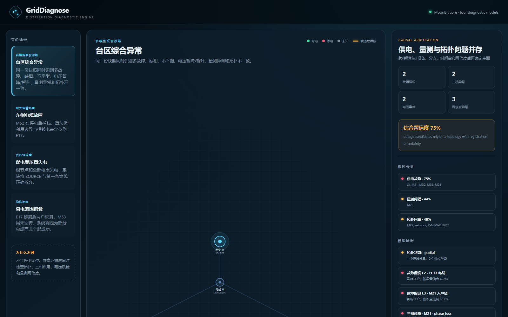

# GridDiagnose

Current release: `0.4.0`

GridDiagnose is a MoonBit-native diagnostic engine for low-voltage distribution
networks. One shared evidence and topology layer supports four different
operational problems:

- fault-section localization and multi-fault decomposition;
- phase loss, three-phase unbalance, undervoltage, and overvoltage;
- voltage-sag and voltage-swell event detection;
- stale, frozen, out-of-order, and topologically inconsistent telemetry.

The project started as the narrower GridLatch outage locator. Version `0.2.0`
retains GridLatch as a compatible diagnostic module while broadening the
project into a reusable distribution-grid diagnostic engine.



## Why GridDiagnose

Distribution operators do not receive one clean signal when equipment fails.
They receive a mixture of last-gasp messages, stale samples, phase voltages,
power-quality traces, and inaccurate topology records. Treating each alert as
an independent dashboard event creates noise; treating every incident as a
single outage model misses phase, quality, and measurement problems.

GridDiagnose provides a common diagnostic contract:

1. Normalize observations, timestamps, and confidence.
2. Represent devices and physical sections as a graph.
3. Evaluate different scenario models against that graph.
4. Return typed findings, severity, confidence, affected objects, and evidence.

The result is useful for utility dispatch, campus and park power systems,
industrial auxiliary supplies, building electrical operations, microgrids, and
commissioning teams. It is not limited to one fixed fault workflow.

## Diagnostic models

### Outage and fault-section diagnosis

The legacy GridLatch model compares proposed open edges with observed meter
states. It handles missing communication evidence, confidence decay, source
outage candidates, and restoration checks.

Version `0.2.0` added greedy multi-fault decomposition: each accepted hypothesis
must explain at least one currently unexplained outage, then its affected
subtree is masked before the next hypothesis is evaluated.

### Phase diagnosis

`phase_readings` provide A/B/C voltages at one or more nodes. The engine detects:

- loss of one or two phase voltages;
- voltage unbalance above warning and critical thresholds;
- sustained undervoltage;
- sustained overvoltage.

### Power-quality diagnosis

`voltage_series` provide timestamped voltages. The engine uses interval-aware
grouping to identify voltage-sag and voltage-swell events, duration, extreme
voltage, and relative deviation from nominal.

### Telemetry integrity diagnosis

`telemetry_series` and `topology_links` expose operational data problems that a
pure fault locator cannot explain:

- stale latest samples;
- frozen values over a configurable window;
- duplicate or decreasing timestamps;
- missing series;
- declared parent differing from an observed parent.

## Topology coverage

`assess_topology` classifies:

- **radial**: one connected component and no cycle;
- **weakly meshed**: one connected component with independent cycles;
- **partial**: unregistered relationships or isolated meter nodes;
- **disconnected**: multiple connected components;
- **empty**: no nodes.

Outage fault localization still requires a rooted tree. If the topology is not
radial, the combined report keeps the topology and other diagnostic findings and
records that outage localization was skipped rather than silently making an
unsafe approximation.

## Quick start

Install MoonBit, then run:

```bash
moon update
moon check --target wasm-gc --deny-warn
moon test --target wasm-gc --deny-warn
moon test --target js --deny-warn

# Portable JavaScript backend:
moon run cmd/griddiagnose --target js -- diagnose examples/griddiagnose_multimodel.json

# Machine-readable report:
moon run cmd/griddiagnose --target js -- diagnose examples/griddiagnose_multimodel.json --json

# Legacy outage commands remain available:
moon run cmd/griddiagnose --target js -- analyze examples/branch_fault.json
moon run cmd/griddiagnose --target js -- verify examples/restore_case.json
```

A Native build can be used when a C/MSVC toolchain is available:

```bash
moon run cmd/griddiagnose --target native -- diagnose examples/griddiagnose_multimodel.json
```

## Combined input

The unified input is defined by
[`schema/griddiagnose-input.schema.json`](schema/griddiagnose-input.schema.json).
Only `analysis_time` is mandatory; each diagnostic section may be supplied
independently.

```json
{
  "analysis_time": 500,
  "network": {
    "root": "T1",
    "nodes": [
      {"id": "T1", "kind": "source"},
      {"id": "J1", "kind": "junction"},
      {"id": "M1", "kind": "meter"}
    ],
    "edges": [
      {"id": "E0", "from": "T1", "to": "J1", "section": "feeder"},
      {"id": "E1", "from": "J1", "to": "M1", "section": "service M1"}
    ]
  },
  "unknown_topology_edge_ids": ["X-NEW"],
  "observations": [
    {"node_id": "M1", "state": "outage", "confidence": 0.97}
  ],
  "phase_readings": [
    {
      "node_id": "M1",
      "timestamp": 499,
      "a_voltage": 230,
      "b_voltage": 230,
      "c_voltage": 0
    }
  ],
  "voltage_series": [
    {
      "node_id": "M1",
      "nominal_voltage": 230,
      "samples": [
        {"timestamp": 490.00, "voltage": 230},
        {"timestamp": 490.01, "voltage": 178},
        {"timestamp": 490.02, "voltage": 230}
      ]
    }
  ]
}
```

The older outage-only contract remains available at
[`schema/gridlatch-input.schema.json`](schema/gridlatch-input.schema.json).

## Cross-model causal arbitration

The `diagnose` command does not stop at concatenating independent reports. It
cross-checks object IDs across models and classifies the incident into:

- `supply_fault`;
- `measurement_issue`;
- `topology_issue`;
- `mixed`;
- `no_incident`.

The arbitration uses relationships that single-threshold checks cannot express:

- supply findings supported by outage, phase, or voltage evidence are grouped
  into one electrical-supply hypothesis;
- a supply finding co-located with a frozen, stale, or clock-invalid series is
  downgraded to a measurement hypothesis when no independent outage confirms
  it;
- declared-vs-observed parent mismatch and unregistered topology objects create
  a topology hypothesis;
- outage results produced on a partial topology retain an explicit topology
  caveat;
- when distinct physical, measurement, and registration problems coexist, the
  primary class is `mixed` and each cause remains separately actionable.

The report includes cause confidence, subject IDs, supporting models, evidence,
conflicts, and a recommended action. This is the project's core independent
contribution: it turns multiple detectors into an explainable root-cause
decision.

Scores are sums of signed feature contributions normalized with a stable
softmax. The JSON report includes the complete feature-weight trace and the
margin between the top two causes, allowing the decision to be audited rather
than trusted as an opaque label.

## Combined report

The `diagnose` command returns separate sections rather than combining
unrelated failure models into one opaque score:

```text
GridDiagnose combined diagnostic report
Analysis time: 500 s
Critical findings: 6
Warnings: 3

Primary diagnosis: supply_fault (89.8%)
Decision margin: 81.5%
  [supply_fault] 89.8% -> J3, M31, M32, M33, M21
  [topology_issue] 8.3% -> M22, network, X-NEW-DEVICE
  [measurement_issue] 1.9% -> M22
  conflict: outage candidates rely on a topology with registration uncertainty

Topology: partial
  nodes=9 edges=8 components=1 cycles=0

Outage hypotheses: 2
  1. E2 [J1-J3 cable] stage confidence 49.85%
     affected: M31, M32, M33
  2. E3 [M21 service] stage confidence 80.16%
     affected: M21

Phase findings: 2
  [critical] M21 phase_loss
  [critical] M31 voltage_unbalance

Power-quality events: 2
  [critical] M33 voltage_sag
  [warning] M33 voltage_swell

Telemetry findings: 3
  [warning] M22 clock_anomaly
  [warning] M22 stuck_series
  [critical] M22 topology_mismatch
```

A committed machine-readable result is available in
[`examples/griddiagnose_multimodel_output.json`](examples/griddiagnose_multimodel_output.json).

## Evaluation

The legacy outage benchmark contains 36 reproducible scenarios:

| Metric | Result |
|---|---:|
| Overall Top-1 accuracy | 91.7% |
| Top-3 recall | 94.4% |
| Mean affected-meter Jaccard | 92.6% |
| Clean-scenario Top-1 | 100% |
| Mixed-scenario Top-1 | 91.7% |
| Severe-scenario Top-1 | 83.3% |

The multi-model benchmark contains 60 deterministic cases, 12 per model:

| Model | Passed | Accuracy |
|---|---:|---:|
| Multi-fault outage | 12/12 | 100% |
| Phase diagnosis | 12/12 | 100% |
| Power quality | 12/12 | 100% |
| Telemetry integrity | 12/12 | 100% |
| Causal arbitration | 12/12 | 100% |

These are synthetic benchmark suites with controlled ground truth. They
demonstrate behavior and regression safety, not field accuracy on a specific
utility network.

Reproduce both:

```bash
moon build cmd/griddiagnose --target js --release

python scripts/evaluate.py \
  --bin _build/js/release/build/cmd/griddiagnose/griddiagnose.js \
  --cases 36

python scripts/evaluate_multimodel.py \
  --bin _build/js/release/build/cmd/griddiagnose/griddiagnose.js \
  --cases-per-model 12
```

## Interactive demo

```bash
moon build cmd/griddiagnose --target js --release
python scripts/build_demo_data.py
```

Open [`demo/index.html`](demo/index.html). The first scenario is a combined
diagnosis containing two independent fault sections, a missing phase, three-
phase unbalance, voltage sag and swell, a frozen/stale telemetry series, a clock
anomaly, partially unknown topology, and a confirmed topology mismatch.

## Relationship to existing MoonBit projects

- `MoonElec` computes electrical formulas.
- `moon-power-flow` and `GridFlow` solve steady-state power flow.
- `MoonSignalKit` provides general streaming statistics and CUSUM utilities.
- `moon-stream-quality` provides generic stream-quality rules.
- GridDiagnose applies physical distribution-network context to combine
  topology, outage, phase, power-quality, and telemetry evidence.

The project does not duplicate a power-flow solver, a generic statistics
library, or a generic data-quality rule engine.

## Scope and safety

GridDiagnose is decision support, not a protection relay or SCADA controller.
The current release does not perform full unbalanced power flow, protection
coordination, switching commands, or automatic dispatch.

- Outage localization supports a rooted radial topology.
- Weakly meshed and partial networks are classified, but unknown physical
  relationships are not guessed.
- Multi-fault decomposition is greedy and should be treated as ranked
  guidance.
- Phase and power-quality thresholds are configurable defaults, not universal
  standards.
- Operator review is required before field work or switching.

See [`docs/DESIGN.md`](docs/DESIGN.md),
[`docs/ALGORITHM.md`](docs/ALGORITHM.md),
[`docs/DEPLOYMENT.md`](docs/DEPLOYMENT.md), and
[`docs/EVALUATION.md`](docs/EVALUATION.md) for the detailed contracts.

## Repository map

- `inference.mbt`, `multi_fault.mbt`: outage and multi-fault diagnosis.
- `topology.mbt`, `topology_assessment.mbt`: radial localization and general
  topology classification.
- `phase.mbt`: phase-loss and three-phase supply diagnosis.
- `power_quality.mbt`: sag and swell event detection.
- `telemetry.mbt`: telemetry integrity and topology consistency.
- `diagnostic.mbt`, `diagnostic_io.mbt`: unified report and JSON contract.
- `cmd/griddiagnose`: CLI.
- `examples/`: hand-checkable legacy and combined scenarios.
- `demo/`: interactive multi-model dashboard.
- `scripts/`: generators, benchmarks, release checks, and demo builder.

## License

Apache-2.0. See [LICENSE](LICENSE).
