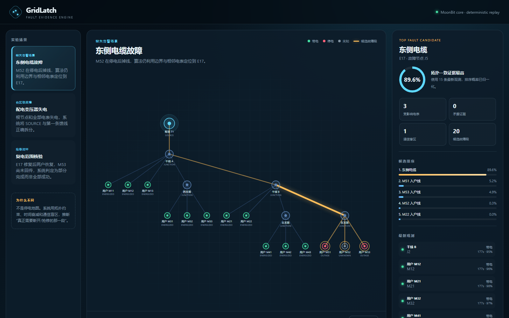

# GridLatch

GridLatch is a MoonBit-native fault localization engine for low-voltage
distribution networks. It converts noisy smart-meter outage evidence and a
known radial topology into an actionable fault section, affected-customer list,
confidence score, and restoration checklist.

The project targets a concrete operational problem: outage maps show which
houses are dark, but field crews still need to know which cable section to
inspect first. GridLatch produces that missing diagnostic layer and can run
offline in a Native process or JavaScript/WebAssembly deployment.



## Why GridLatch

- **Useful outside a demo:** the output is a ranked cable section, affected
  meter set, evidence explanation, and post-repair verification.
- **Built for incomplete data:** communication dropouts are `unknown`, not
  forced into powered/outaged states. Observation confidence and age decay are
  included in the score.
- **Topology aware:** a candidate is not a nearest alert. It is a tree edge whose
  expected downstream outage footprint is compared with the observed state of
  the whole feeder.
- **Explainable by construction:** every candidate reports supporting,
  contradicting, and blind nodes.
- **Small deployment surface:** the core is deterministic, has no database or
  network dependency, and supports WebAssembly-friendly builds.

This is distinct from existing MoonBit electrical libraries such as
[MoonElec](https://github.com/SupremeHuaji/MoonElec),
[moon-power-flow](https://github.com/Duckweed-yhb/moon-power-flow), and
[GridFlow](https://github.com/Zcxssxx/gridflow). Those projects calculate
circuit quantities or steady-state power flow. GridLatch consumes outage
events and locates a fault section.

## Quick start

Install the MoonBit toolchain, then run:

```bash
moon check --target wasm-gc --deny-warn
moon test --target wasm-gc --deny-warn

# Native backend when an MSVC/C toolchain is available:
moon run cmd/gridlatch --target native -- analyze examples/branch_fault.json

# Portable JavaScript backend:
moon run cmd/gridlatch --target js -- analyze examples/branch_fault.json
```

Example output:

```text
Top candidate: E17 [east cable]
Fault node: J5
Confidence: 89.59167786154045%
Affected meters (3): M51, M52, M53
Supporting nodes: J2, M11, M12, ...
Contradicting nodes: (none)
Blind nodes: M52
```

Use `--json` for machine-readable output:

```bash
moon run cmd/gridlatch --target js -- analyze examples/branch_fault.json --json
```

Verify a repair:

```bash
moon run cmd/gridlatch --target js -- verify examples/restore_case.json
```

## Interactive demo

Build the JavaScript CLI, regenerate the demo from real CLI responses, then open
[`demo/index.html`](demo/index.html):

```bash
moon build cmd/gridlatch --target js --release
python scripts/build_demo_data.py
```

The demo contains three deterministic scenarios:

1. A branch cable fault with one meter offline for communication reasons.
2. A transformer/feeder-wide outage.
3. A partial restoration where one repaired meter has not yet reported back.

## Input contract

The network must be a single connected radial tree. Meters and junctions are
nodes; each edge is a field-testable section.

```json
{
  "analysis_time": 180,
  "network": {
    "root": "T1",
    "nodes": [
      {"id": "T1", "kind": "source"},
      {"id": "J1", "kind": "junction"},
      {"id": "M1", "kind": "meter"}
    ],
    "edges": [
      {"id": "E0", "from": "T1", "to": "J1", "section": "feeder"},
      {"id": "E1", "from": "J1", "to": "M1", "section": "service M1"}
    ]
  },
  "observations": [
    {
      "node_id": "M1",
      "state": "outage",
      "confidence": 0.96,
      "observed_at": 177
    }
  ]
}
```

`state` accepts `energized`, `outage`, or `unknown`. The newest observation per
node wins. Missing `confidence` defaults to `1.0`; missing `observed_at`
defaults to `analysis_time`.

The machine-readable contract is in
[`schema/gridlatch-input.schema.json`](schema/gridlatch-input.schema.json).

## Algorithm

For every non-root tree node, the candidate hypothesis is “the edge immediately
above this node is the failed section”. Its expected outage set is the
downstream subtree. The `SOURCE` hypothesis represents complete feeder loss.

Each observation contributes evidence according to:

```text
weight = confidence * 0.5 ^ ((analysis_time - observed_at) / half_life)
score  = sum(compatible weighted evidence)
       - sum(weighted contradictions * class penalty)
       - structural prior
```

Candidate scores are normalized with a stable softmax. This produces a ranked
fault-section distribution rather than an opaque binary alarm. See
[the design note](docs/DESIGN.md) for assumptions, failure paths, and complexity.

## Evaluation

The repository includes a deterministic benchmark generator with 36 scenarios
across three noise levels. It injects:

- 2%, 12%, or 28% communication dropouts;
- 1%, 4%, or 8% false meter-state reports;
- branch, trunk, and feeder faults;
- delayed observations and low-confidence evidence.

| Metric | Result |
|---|---:|
| Overall Top-1 accuracy | 91.7% |
| Top-3 recall | 94.4% |
| Mean affected-meter Jaccard | 92.6% |
| Clean-scenario Top-1 | 100% |
| Mixed-scenario Top-1 | 91.7% |
| Severe-scenario Top-1 | 83.3% |
| Nearest-outage-edge baseline | 0% |
| CLI median latency | 70.9 ms |

The baseline is intentionally simple: it follows the first outaged meter to a
leaf service edge. It is not a substitute for a utility production model. The
benchmark uses synthetic topology and reproducible fault injection because
customer-level low-voltage outage data is normally private. Reproduce it with:

```bash
moon build cmd/gridlatch --target js --release
python scripts/evaluate.py \
  --bin _build/js/release/build/cmd/gridlatch/gridlatch.js \
  --cases 36
```

See [`benchmark/results.json`](benchmark/results.json) and
[`docs/EVALUATION.md`](docs/EVALUATION.md) for the complete methodology.

## Scope and safety

GridLatch is a decision-support prototype, not a protection relay or a
production SCADA controller. The current release assumes:

- one simultaneous fault;
- a known, connected radial tree;
- meter status as the primary evidence;
- branch-point telemetry is optional.

The output should be reviewed by an operator before switching or field work.
Support for multiple faults, unmodeled topology changes, phase-level voltage
evidence, and utility-specific state-estimation interfaces is future work.

## Repository map

- `model.mbt`, `topology.mbt`: typed network model and radial-tree validation.
- `inference.mbt`: weighted topology-aware fault ranking.
- `json_io.mbt`: documented JSON input/output contract.
- `cmd/gridlatch`: CLI entry point.
- `examples/`: hand-checkable fault and restoration cases.
- `demo/`: zero-build interactive SVG dashboard.
- `scripts/`: deterministic case generator, evaluator, and demo builder.
- `docs/`: design, evaluation, and architecture notes.

## License

Apache-2.0. See [LICENSE](LICENSE).
