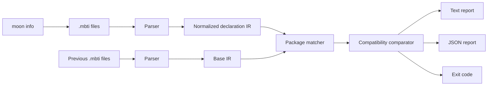

# Architecture

MoonCompat has a small library layer and a native/CLI layer.



## Library package

The root package contains the reusable engine:

- `types.mbt`: snapshots, declarations, changes, reports, and SemVer types;
- `parser.mbt`: `.mbti` parsing, canonicalization, derive normalization, and deterministic sorting;
- `compare.mbt`: single-package and multi-package comparisons;
- `render.mbt`: human-readable and JSON renderers.

The public API is intentionally usable without the filesystem or CLI:

```moonbit
let base = @mooncompat.parse_api(base_source)
let head = @mooncompat.parse_api(head_source)
let report = @mooncompat.compare_snapshots(base, head)
let json = @mooncompat.render_report_json(report)
```

## CLI package

`cmd/main` owns:

- recursive `.mbti` discovery;
- ignored build/dependency directories;
- reading files;
- writing text or JSON output;
- command-line parsing and help;
- process exit codes.

The comparison library does not depend on filesystem APIs. This keeps it usable on `wasm`, `wasm-gc`, `js`, and `native`.

## Determinism

Declarations and changes are sorted with lexical string ordering. JSON uses a fixed `schema_version`, field order, and two-space indentation. Identical inputs therefore produce stable, reviewable output suitable for snapshot tests.

## Failure model

Input and parse failures are surfaced as non-zero CLI exits. The CLI distinguishes a compatibility result (`1`) from an invalid check (`2`), which prevents infrastructure errors from being mistaken for a normal failed API gate.
